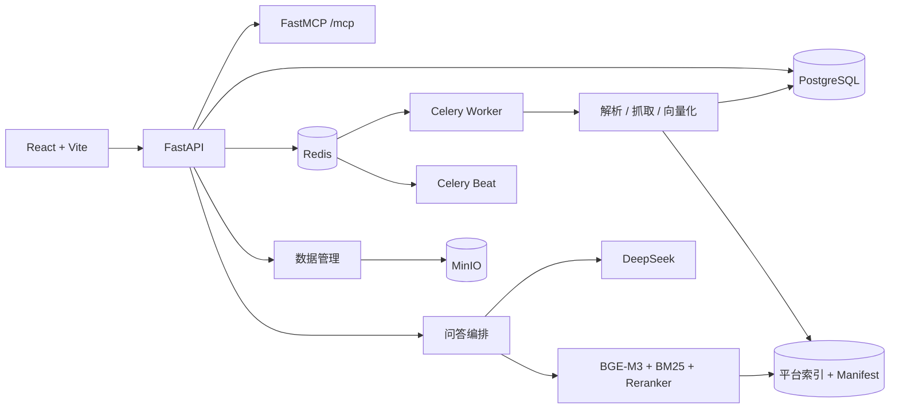

# 东煌纪 · Evidence-first Competitive Intelligence ChatBI

一个可自托管的多用户竞品情报工作台。它把多产品资料库、混合检索、DeepSeek
流式回答和只读 MCP 组合在一起，所有回答都要求引用本轮原文证据。

项目适合以下场景：

- 游戏发行、运营和产品团队统一管理竞品资料。
- 基于自有语料进行带引用的竞品问答和报告生成。
- 通过 MCP 把只读检索能力接入其他 Agent 工具。
- 演示完整的数据上传、网站增量抓取、后台索引和权限隔离链路。

## 核心能力

- React 三栏工作台：分析卷宗、对话结论、同屏证据。
- BGE-M3 语义召回、BM25 关键词召回、RRF 融合和 BGE-Reranker。
- DeepSeek 流式回答，`S1` 等引用编号可定位到右侧原文。
- 严格证据闸门；没有足够资料时不调用生成模型。
- PDF、DOCX、XLSX、CSV、Markdown、TXT 网页上传和后台解析。
- 官网增量抓取、原始快照、抓取量保护和数据管理后台。
- 邀请注册、Argon2id、HttpOnly Cookie、团队只读共享和个人副本。
- PostgreSQL、Redis、Celery、MinIO/S3、nginx 和 GPU 向量化。
- BGE-M3/Reranker 不可用时自动降级到 BM25/词项评分。
- 只读 Streamable HTTP MCP。

## 技术架构



该架构刻意保持为 Docker 模块化单体。约数千个分块时，本地 NumPy 索引和
单机 Compose 比引入 Kubernetes 或独立向量数据库更简单。

## 演示数据

仓库只包含 4 篇合成演示资料，不包含开发期间的私有或第三方抓取语料。

```powershell
python backend/scripts/create_demo_data.py --force
```

生产使用前请导入你有权处理的资料，并遵守目标网站的版权、robots、接口条款
和访问频率要求。更多说明见 [NOTICE.md](NOTICE.md)。

## 快速启动

要求：

- Docker Desktop 或 Docker Engine + Compose
- Python 3.12（本地测试和数据脚本）
- Node.js 22+（前端开发）
- 可选 NVIDIA GPU；CPU 模式可把 `MODEL_DEVICE` 改为 `cpu`
- 本地 BGE-M3 与 BGE-Reranker 模型目录

复制环境模板：

```powershell
Copy-Item .env.production.example .env
```

至少替换 `.env` 中的数据库密码、MinIO 密码、`SECRET_KEY`、
`BOOTSTRAP_ADMIN_TOKEN`、`MCP_ACCESS_TOKEN` 和 `DEEPSEEK_API_KEY`。

模型目录通过 `MODEL_ROOT` 指定，Compose 会把它挂载为 `/models`：

```dotenv
MODEL_ROOT=../BAAI
BGE_M3_PATH=/models/bge-m3
BGE_RERANKER_PATH=/models/bge-reranker-base
```

启动：

```powershell
powershell -ExecutionPolicy Bypass -File scripts/start.ps1
```

打开 [http://127.0.0.1:8080](http://127.0.0.1:8080)，使用
`BOOTSTRAP_ADMIN_TOKEN` 创建首位平台管理员。

也可以直接使用 Compose：

```bash
docker compose up -d --build
docker compose ps
```

## 数据导入

导入一个包含 `index/local_index.pkl`、`corpus/` 和 `gold_set.jsonl` 的目录：

```powershell
$env:PYTHON = "python"
powershell -ExecutionPolicy Bypass -File scripts/import-data.ps1 `
  -Source "<数据目录>"
```

也可以登录“管理 → 数据管理”后上传单个文件或执行官网增量抓取。

## 测试

```powershell
$env:PYTHON = "python"
powershell -ExecutionPolicy Bypass -File scripts/test.ps1 -SkipEval
```

完整评测需要本地 BGE 模型：

```powershell
powershell -ExecutionPolicy Bypass -File scripts/test.ps1
```

评测要求 `Hit@5 >= 0.80`。仓库内演示评测集只有 4 道合成题，仅用于验证
流水线可运行，不代表真实业务语料上的检索质量。

容器验收：

```powershell
powershell -ExecutionPolicy Bypass -File scripts/verify-docker.ps1
```

## MCP

服务启动后：

```text
http://127.0.0.1:8080/mcp/
```

生产模式需要：

```text
Authorization: Bearer <MCP_ACCESS_TOKEN>
```

工具：`search_sources`、`get_document`、`compare_products`。MCP 只读。

## 安全

- `.env`、运行时上传、模型目录、平台索引和私有语料不会进入 Git。
- 生产配置会拒绝占位或过短密钥。
- API/Worker 以非 root 用户运行，并启用只读根文件系统、资源限制和安全响应头。
- 登录失败节流、管理员临时密码、强制改密、每日配额和审计清理均已内置。
- 公网部署前仍需配置 TLS、SSO、备份恢复、监控告警和密钥轮换。

漏洞报告方式见 [SECURITY.md](SECURITY.md)。

## 开发

```powershell
pip install -e "backend[test]"
cd frontend
npm ci
npm test -- --run
npm run build
```

贡献规则见 [CONTRIBUTING.md](CONTRIBUTING.md)。

## License

源代码采用 [MIT License](LICENSE)。运行语料、模型权重、游戏商标和第三方网页
内容不包含在 MIT 授权范围内，详见 [NOTICE.md](NOTICE.md)。
